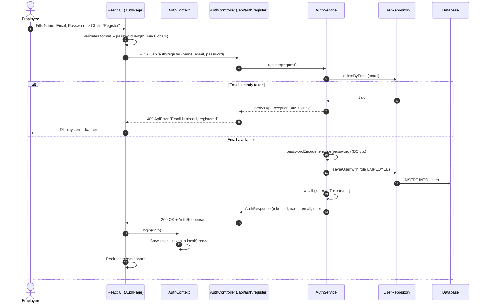
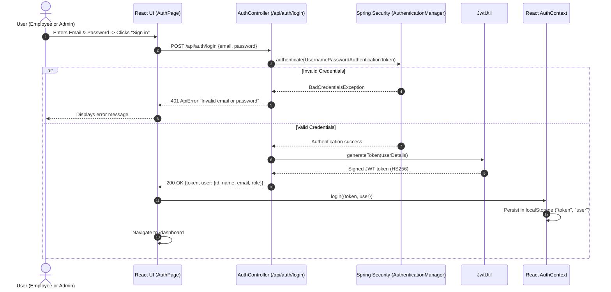
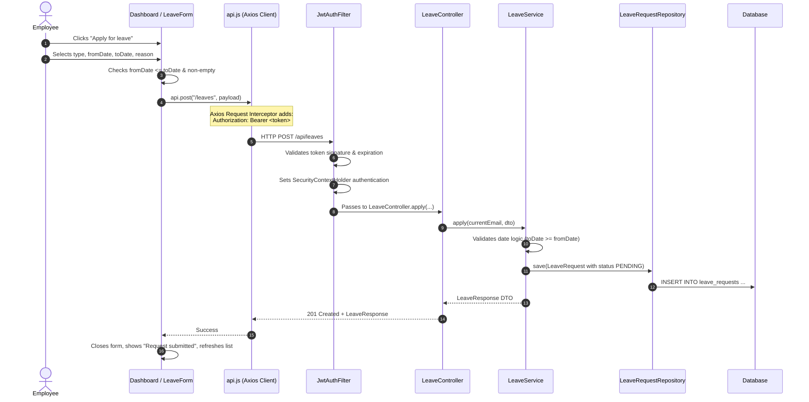
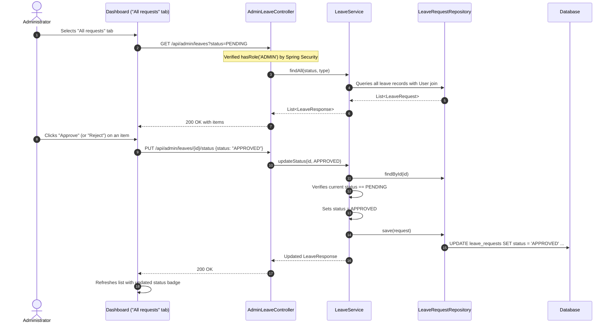

# Employee Leave Management System — Architecture & Workflow Guide

This document provides a comprehensive technical guide explaining how the Employee Leave Management System works from end to end: its architecture, data flows, security mechanisms, state management, and file breakdown.

---

## 1. High-Level Architecture Overview

The system follows a modern decoupled client-server architecture:

```
[ Client Browser ]
        │
        │ HTTP / HTTPS (JSON)
        ▼
[ React 18 Single Page App (Vite) ]
  ├── AuthContext (Global Session & LocalStorage Sync)
  ├── Axios API Client (Base URL detection & JWT interceptor)
  └── UI Components (AuthPage, Dashboard, LeaveForm)
        │
        │ REST API calls with "Authorization: Bearer <JWT>"
        ▼
[ Spring Boot 4 Backend (Java 17) ]
  ├── Spring Security Filter Chain
  │     ├── CorsFilter
  │     └── JwtAuthFilter (Extracts and validates token per request)
  ├── Controllers (REST Endpoints: /api/auth, /api/leaves, /api/admin/leaves)
  ├── Services (Business logic, validation, transaction boundaries)
  ├── Repositories (Spring Data JPA interfaces)
  └── Database (MySQL 8 / H2 in-memory compatibility fallback)
```

---

## 2. Core Entities & Roles

### User Roles
* **`EMPLOYEE`**: Default role assigned upon registration. Can create, view, update, and cancel their own leave requests while in `PENDING` status.
* **`ADMIN`**: Privileged role. Can view all organizational leave requests across all employees, filter them, and approve or reject pending requests. Also has access to apply for personal leave.

### Leave Types
* `SICK`: Medical or health-related absence.
* `CASUAL`: Short personal time off.
* `ANNUAL`: Scheduled vacation / annual holiday.
* `UNPAID`: Leave without pay.

### Leave Request Statuses
* `PENDING`: Initial state upon submission. Only pending requests can be modified, cancelled, approved, or rejected.
* `APPROVED`: Finalized positive decision made by an Administrator. Immutable.
* `REJECTED`: Finalized negative decision made by an Administrator. Immutable.

---

## 3. End-to-End System Workflows

### Flow 1: User Registration


---

### Flow 2: User Login & JWT Authentication


---

### Flow 3: Optional Admin Account Seeding
1. At application boot, `AdminInitializer` implements Spring's `CommandLineRunner`.
2. If `ADMIN_EMAIL` and `ADMIN_PASSWORD` are both set, it checks whether that email exists.
3. If not, it creates an `ADMIN` user named `System Admin` with a BCrypt-hashed password. `ADMIN_PASSWORD` must be at least 8 characters.
4. If nothing is configured or the account exists, it does nothing.

No credentials are stored in source code.

---

### Flow 4: Employee Leave Application


---

### Flow 5: Modifying or Cancelling Pending Leaves
* **Editing a Request**:
  1. The employee clicks **Edit** on a `PENDING` request item.
  2. The `LeaveForm` opens populated with the existing request details.
  3. The employee modifies dates, reason, or type and clicks **Save changes**.
  4. Calls `PUT /api/leaves/{id}`.
  5. `LeaveService` confirms:
     - The request exists.
     - The request belongs to the authenticated user (returns `404 Not Found` if accessed by another user to prevent ID enumeration).
     - The status is currently `PENDING` (returns `409 Conflict` if already processed).
  6. The record is updated and saved.
* **Cancelling a Request**:
  1. The employee clicks **Cancel** and confirms via prompt.
  2. Calls `DELETE /api/leaves/{id}`.
  3. The backend confirms ownership and `PENDING` status, then deletes the record from the database.

---

### Flow 6: Admin Review Flow (Approve / Reject)


---

## 4. Security & Error Handling Architecture

### 1. Stateless JWT Security
* Every API request outside `/api/auth/**` must carry an `Authorization: Bearer <token>` header.
* `JwtAuthFilter` intercepts every incoming HTTP request:
  1. Extracts the Bearer token.
  2. Validates signature with HMAC-SHA256 (`jwt.secret`).
  3. Verifies token expiration.
  4. Loads user authorities into Spring Security's `SecurityContextHolder`.

### 2. Role-Based Access Control (RBAC)
* `/api/auth/**` -> Public.
* `/api/leaves/**` -> Accessible by authenticated users with role `EMPLOYEE` or `ADMIN`.
* `/api/admin/**` -> Strictly restricted to users with role `ADMIN`. Requests from standard employees receive `403 Forbidden`.

### 3. ID Probing Protection
* When an employee attempts to view, edit, or cancel a leave ID belonging to another employee, the system intentionally returns **`404 Not Found`** rather than `403 Forbidden`.
* This prevents attackers from enumerating valid leave request IDs across the organization.

### 4. Global Exception Handler (`GlobalExceptionHandler`)
All application exceptions are intercepted and converted into standardized JSON responses (`ApiError`):
* `MethodArgumentNotValidException` -> Returns `400 Bad Request` with field validation errors.
* `ApiException` -> Returns custom HTTP status codes (e.g. `409 Conflict` for duplicate emails or invalid state transitions).
* `BadCredentialsException` -> Returns `401 Unauthorized`.
* `AccessDeniedException` -> Returns `403 Forbidden`.

---

## 5. Codebase Structure & File Mapping

### Backend (`/backend`)
```
backend/src/main/java/com/settribe/leave/
├── LeaveApplication.java           # Spring Boot bootstrap & main()
├── config/
│   ├── SecurityConfig.java         # FilterChain, CORS, BCrypt, Security routes
│   └── AdminInitializer.java      # Seeds default admin account on startup
├── controller/
│   ├── AuthController.java         # /api/auth (register, login)
│   ├── LeaveController.java        # /api/leaves (employee actions)
│   └── AdminLeaveController.java   # /api/admin/leaves (admin actions)
├── service/
│   ├── AuthService.java            # User registration & login business logic
│   └── LeaveService.java           # Leave business logic, validations, CRUD
├── repository/
│   ├── UserRepository.java         # User entity JPA repository
│   └── LeaveRequestRepository.java # LeaveRequest JPA repository + query filters
├── security/
│   ├── JwtAuthFilter.java          # Per-request JWT authentication filter
│   ├── JwtUtil.java                # JWT token creation, signing & parsing
│   └── UserDetailsServiceImpl.java # Spring Security user details provider
├── entity/
│   ├── User.java                   # User database entity
│   ├── LeaveRequest.java           # Leave request database entity
│   ├── Role.java                   # Enum: EMPLOYEE, ADMIN
│   ├── LeaveStatus.java            # Enum: PENDING, APPROVED, REJECTED
│   └── LeaveType.java              # Enum: SICK, CASUAL, ANNUAL, UNPAID
├── dto/
│   ├── AuthResponse.java           # Authentication response with JWT
│   ├── LoginRequest.java           # Login request credentials
│   ├── RegisterRequest.java        # Registration request payload
│   ├── LeaveRequestDto.java        # Leave creation/update payload
│   ├── LeaveResponse.java          # Formatted leave request response
│   └── StatusUpdateRequest.java    # Status change payload (Admin)
└── exception/
    ├── GlobalExceptionHandler.java # @ControllerAdvice centralized exception mapper
    ├── ApiException.java           # Custom runtime exception with HTTP status
    └── ApiError.java               # Standardized error payload
```

### Frontend (`/frontend`)
```
frontend/src/
├── main.jsx                        # React root entrypoint
├── App.jsx                         # React Router routes and Protected wrappers
├── auth.jsx                        # AuthContext, user state, localStorage sync
├── api.js                          # Axios instance, baseURL resolution, 15s timeout, JWT interceptor
├── styles.css                      # Design tokens, responsive grid, dark/light theme, badges
├── pages/
│   ├── LandingPage.jsx             # Public landing page with hero, mockup preview, benefits, security
│   ├── AuthPage.jsx                # Dual-mode Sign In / Sign Up component with inline validation & strength meter
│   └── Dashboard.jsx               # Main application dashboard (4 KPIs, search, filters, sorting, modals)
└── components/
    ├── SettribeLogo.jsx            # Official Settribe vector SVG brand logo with accent bar
    ├── AvatarDropdown.jsx          # Initials button with menu (dark mode toggle, logout)
    ├── LeaveBalanceWidget.jsx      # Leave allowance per type, consumed from the user's requests
    ├── LeaveForm.jsx               # Accessible modal form with duration calculation & character counter
    └── ConfirmModal.jsx            # Accessible in-app confirmation modal (replaces window.confirm)
```


---

## 6. Live Deployment Environment

* **Live Frontend**: [https://leave-management-system-frontend-8v9l.onrender.com](https://leave-management-system-frontend-8v9l.onrender.com)
* **Live Backend**: [https://leave-management-system-1-9uph.onrender.com](https://leave-management-system-1-9uph.onrender.com)
* **Admin account**: set `ADMIN_EMAIL` and `ADMIN_PASSWORD` on the backend to seed one.
